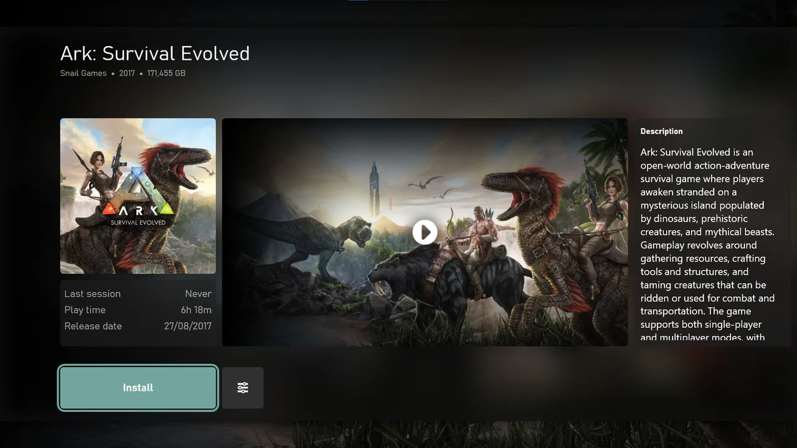

# Home and pinned games

## Pin a game

Open the game details, select More options and choose `Pin to Home`.

## Reorder pinned games

1. Focus the first pinned game and press Left.
2. Select Organize.
3. Choose a game and move it with Left or Right.
4. Confirm to save or press B to cancel.

The Home background can use the profile image or follow the focused game.

