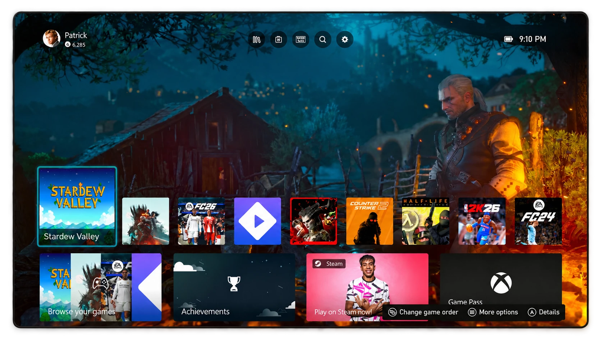
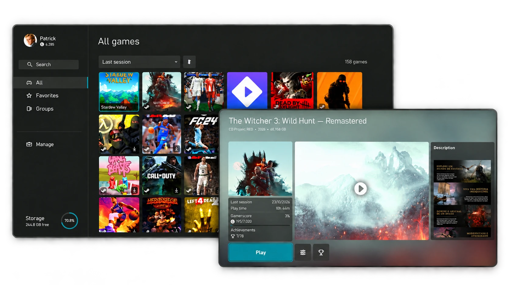
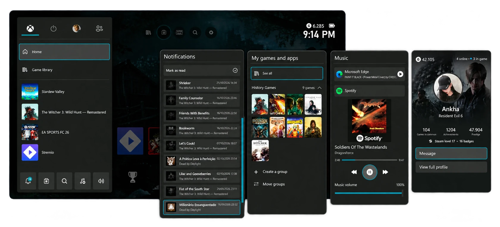
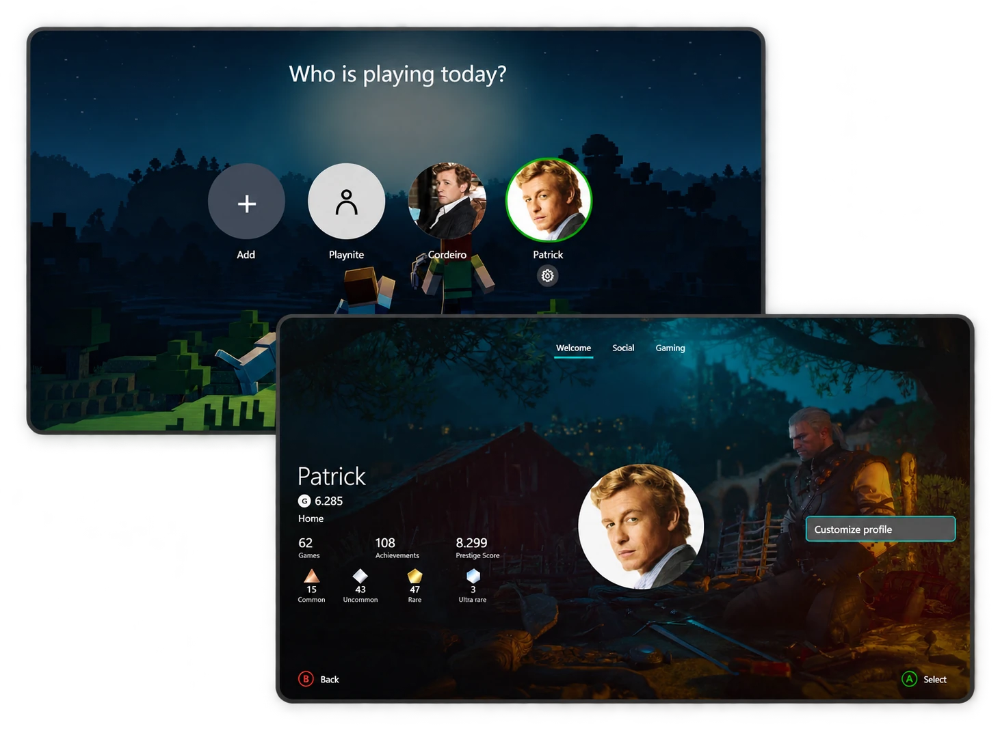
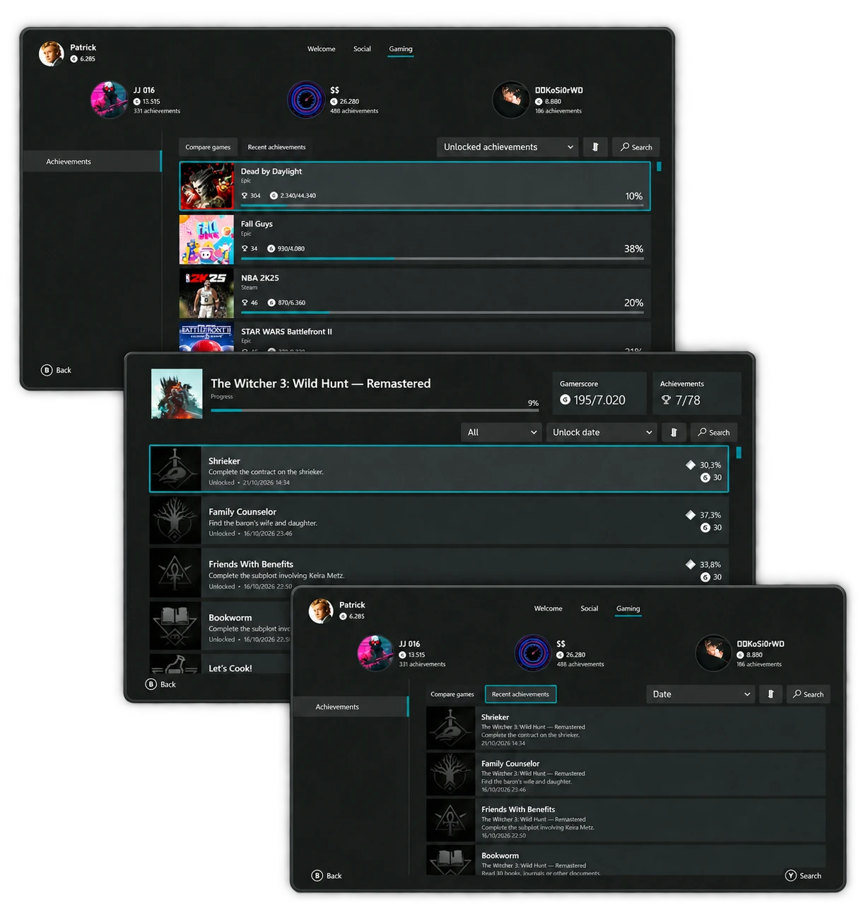

<section class="xn-hero" aria-labelledby="xn-title">

X-NITE / PLAYNITE<h1 id="xn-title">Your PC. Your games. Your way.</h1>
Bring your library to the big screen. Personal profiles, a customizable Home and controller navigation, all in one place.

<a class="xn-button xn-button--community" href="https://buymeacoffee.com/xnite" target="_blank" rel="noopener noreferrer">Join the community ↗</a><a class="xn-text-link" href="#experience">Explore the experience ↓</a>
Windows · Playnite Fullscreen

</section>
<section class="xn-experience" id="experience">
Made for the way you play<h2>An Xbox-inspired experience for Playnite.</h2><i aria-hidden="true"></i>

<section class="xn-feature ">

<h2>Your library, front and centre.</h2>
Pin your favourites to Home, browse your games and keep collections together with groups.
<a class="xn-text-link" href="library-and-groups/">Explore the library ›</a>
</section>
<section class="xn-feature xn-feature--reverse">

<h2>Your Xbox menu, within reach.</h2>
Open your games, notifications and friends from one menu. Keep your shortcuts close, even while a game is running.
<a class="xn-text-link" href="hub-and-friends/#overview">Explore the Xbox menu ›</a>
</section>
<section class="xn-feature ">

<h2>A space that feels like you.</h2>
Give each profile its own avatar, accent colour and backgrounds. Switch profiles and return to your own Home.
<a class="xn-text-link" href="profiles/">Discover profiles ›</a>
</section>
<section class="xn-feature xn-feature--reverse xn-feature--achievements">

<h2>Every achievement tells a story.</h2>
Follow your progress, browse unlocked achievements and compare supported games with your Steam friends.
<a class="xn-text-link" href="achievements/">Explore achievements ›</a>
</section>
</section>
<section class="xn-start">X-NITE<h2>Ready for your next session?</h2>
Follow the illustrated installation guide, from Playnite to your first X-Nite profile.

4 stages19 illustrated steps5 languages
<a class="xn-button" href="installation/01-download-playnite/">Start installation ›</a><a class="xn-text-link" href="help/#performance">Performance and help ›</a></section>

