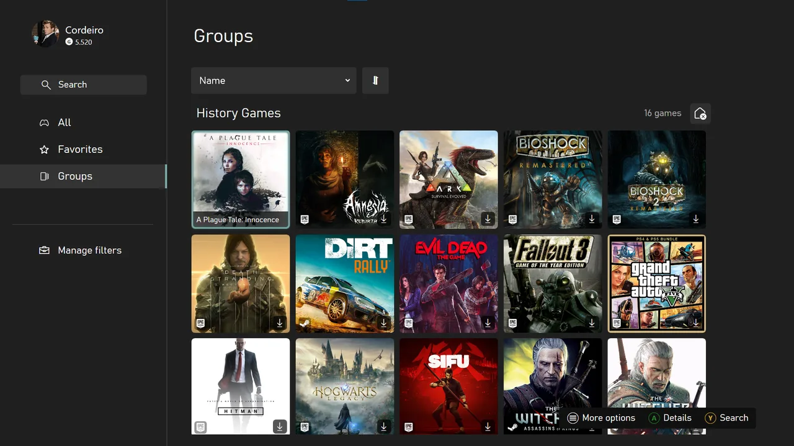

# Library and groups

The library contains All games, Favorites and Groups. Search and sorting apply to the open section.

## Create a group

1. Open Groups and select Create group.
2. Enter a name.
3. Use the add tile to choose games.

You can also use `More options > Add to a group` from game details. Removing a group from Home does not delete it from the library.

