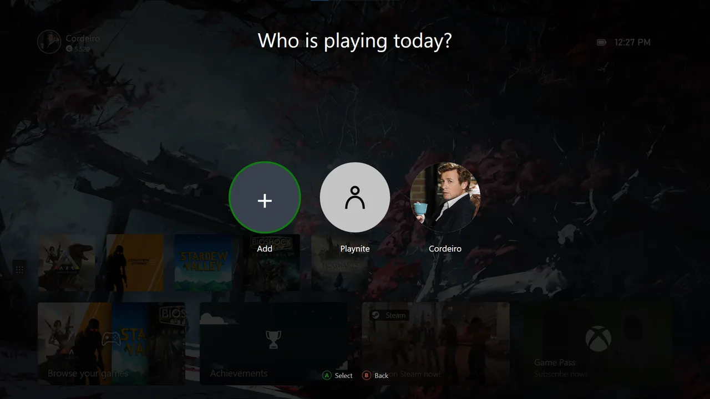
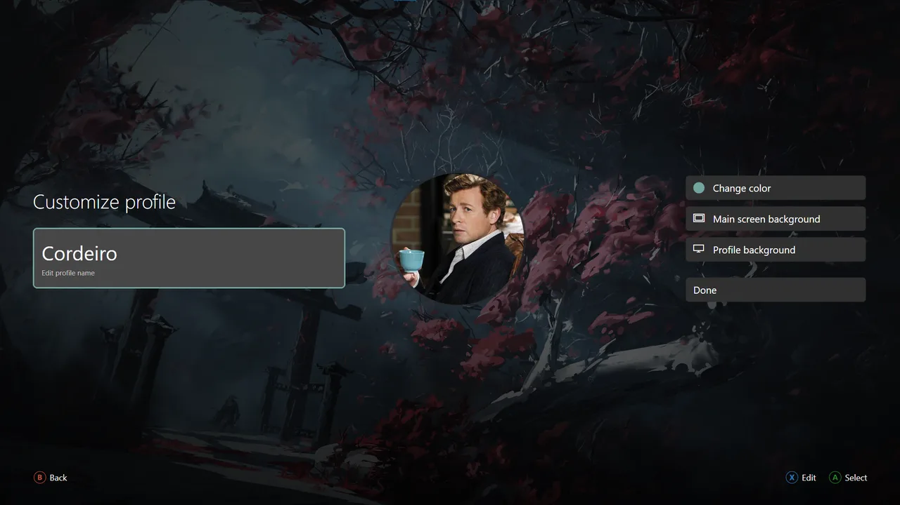
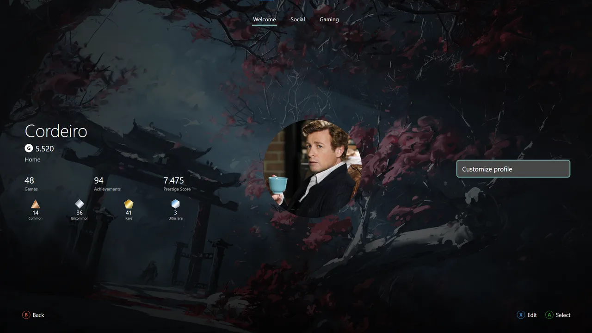

# Profiles

Each profile stores its name, avatar, accent, backgrounds, favorites, groups, recent games, pinned games and Hub preferences.

## Customize a profile

1. Open the Hub and enter your profile.
2. Open customization.
3. Choose the avatar, accent, main background or profile background.
4. Press X to edit an imported item when Edit is available.

Switching profiles immediately restores that person's Home and library choices.

