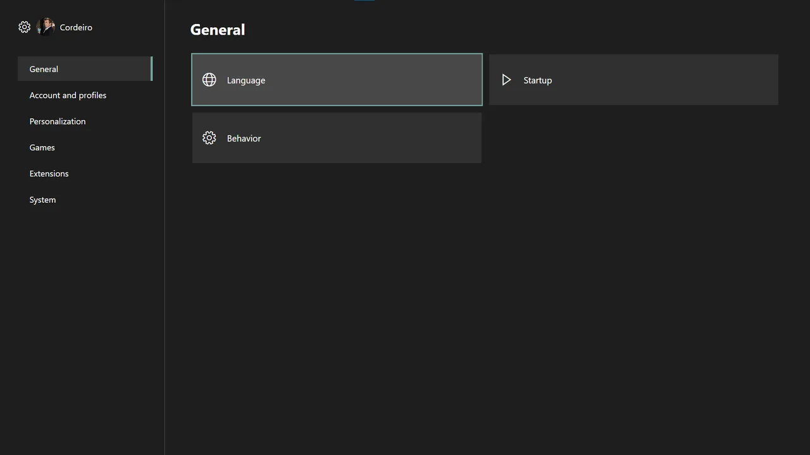

# Settings

The Settings Center groups General, Accounts and profiles, Personalization, Games, Extensions and System options.

Confirm a sidebar section to move focus directly into its first available option. Press B to return to the sidebar. Profile-specific changes apply only to the active profile.
